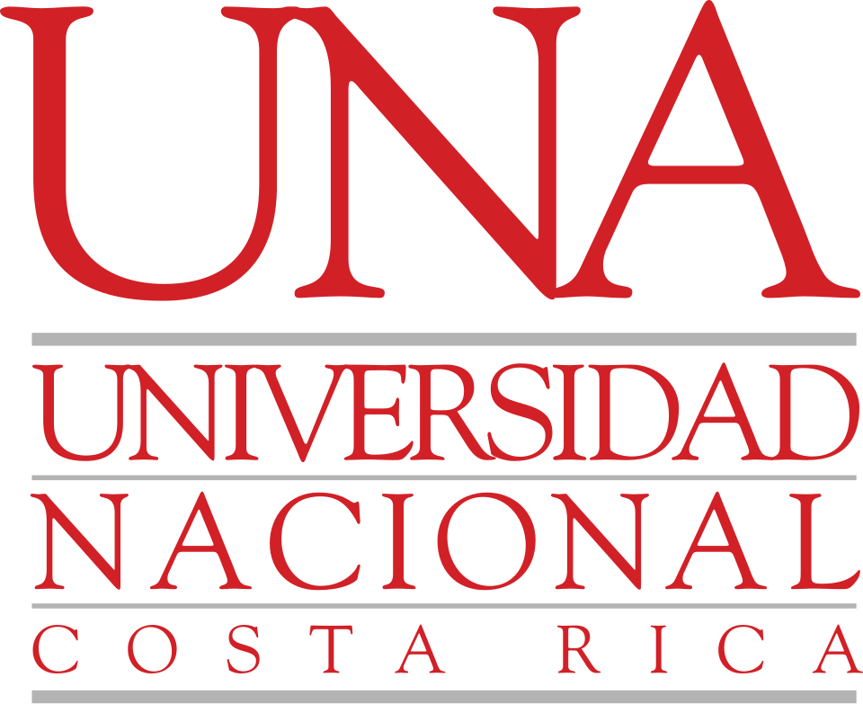

# Material for the LOCMARCA workshop

  
  &nbsp;&nbsp;&nbsp;
  

This repository contains the material used during the LOCMARCA workshop, from 16 to 20 November 2026.

## Program: [here](Programme_LOCMARCA26_update.md)

<!-- Previous version (Google Doc): https://docs.google.com/document/d/1cB4yNvkBNWdxjOYhjzKJLcO5nfagvkhRv2tHxbG7s0o/edit?tab=t.0 -->

## Quick start

**First connection** (Monday, TP0):
1. [Connect to JupyterLab on Kabre](docs/connexion_jupyterhub.md)
2. [Download the course material with git](docs/git_tp_course.md)
3. [Set up your bash environment](docs/bash_env.md)
4. [Select the Python environment](docs/python_env.md)

**Every following connection**: [connect to JupyterLab](docs/connexion_jupyterhub.md), then follow [Hands-on sessions](docs/handson_session.md) (update the material, work in your own copy of each notebook).

## The week

| Day | Morning | Afternoon |
|---|---|---|
| Monday          | Welcome  | TP0: installation (see *Quick start*) — Course 0a (netCDF anatomy), Course 0b (ncview) |
| Tuesday         | Course 1  | [Session01](Session01/): TP1a, TP1b — [Session02](Session02/): TP2a |
| Wednesday       | [Session02](Session02/): TP2b, TP2c |  Course 2 |
| Thursday | [Session03](Session03/): TP3a (NEMO), TP3b (CROCO) | Session 4: mini-project |
| Friday | Presentations, wrap-up | - |

<!-- Complementary notebooks, in [Session02](Session02/): TP2b (climatology vs interannual variability) and TP2c (biogeochemistry). -->

## Courses

Lecture slides are in [Courses](Courses/).

<!-- online [here](https://drive.google.com/drive/folders/1q631u2Uf0dU-dbK6jkZtppacwdYifSWC?usp=sharing). -->
<!-- 
PowerPoint versions are available in [Courses/](Courses/). -->
